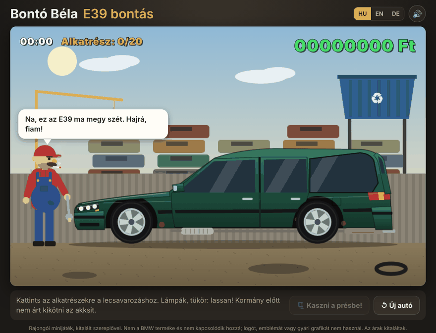
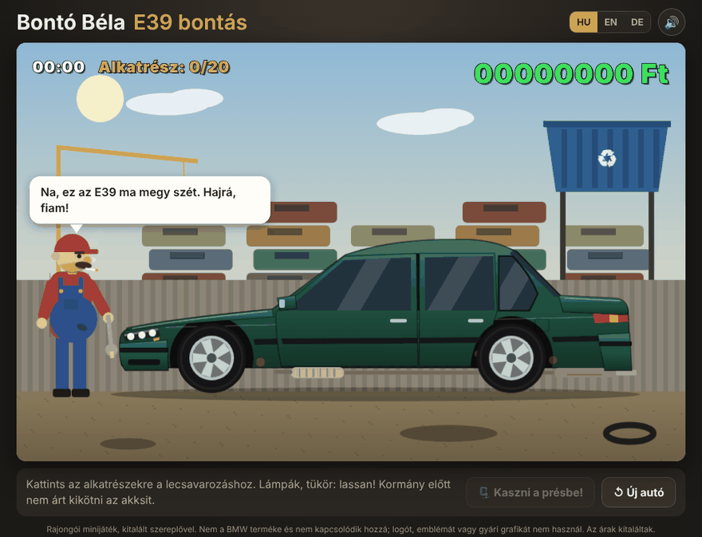
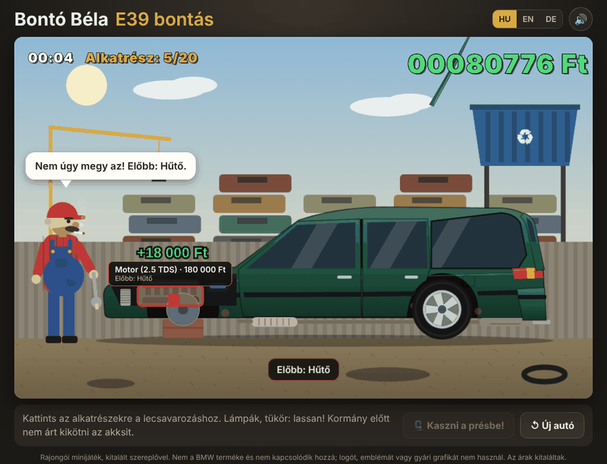
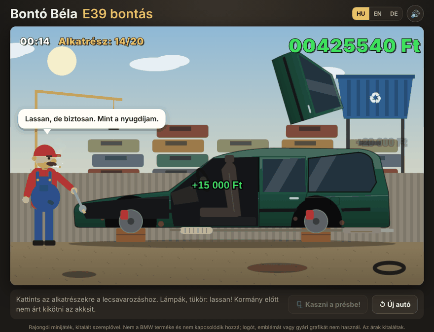
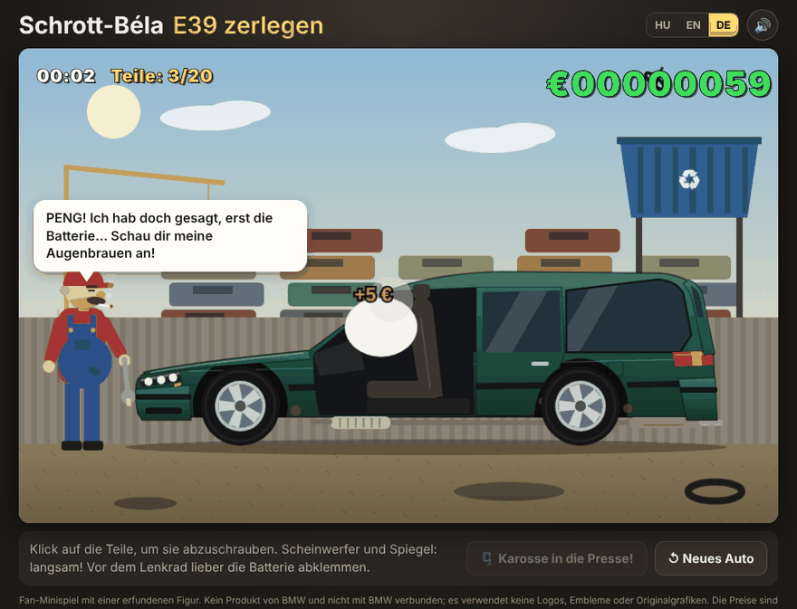
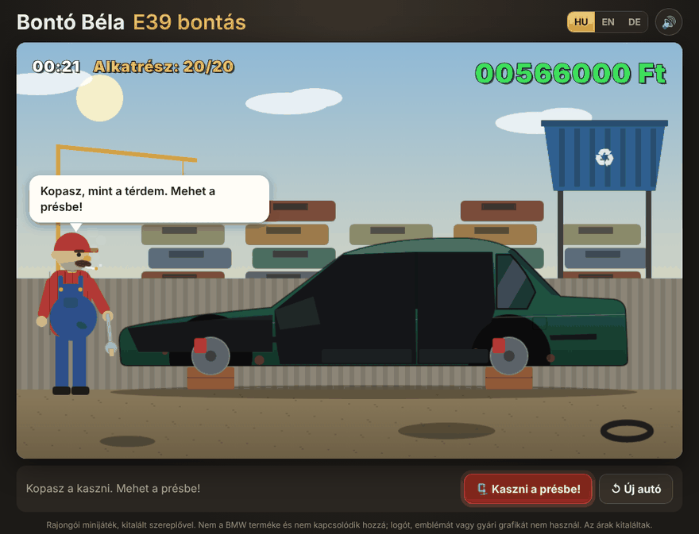
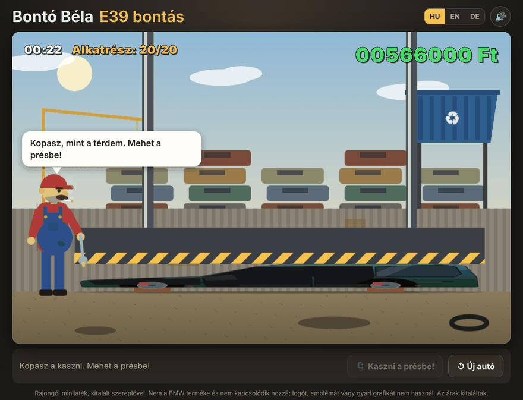
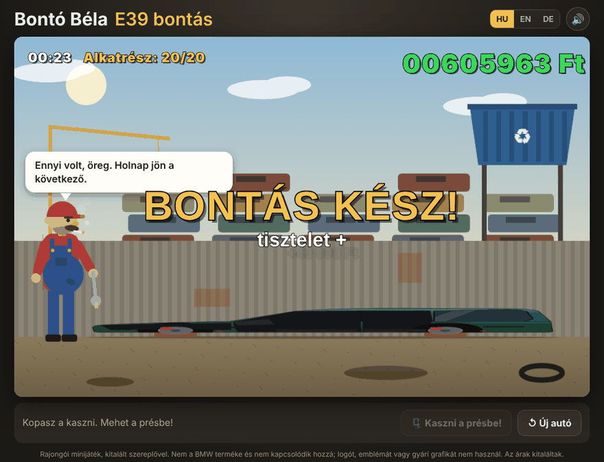
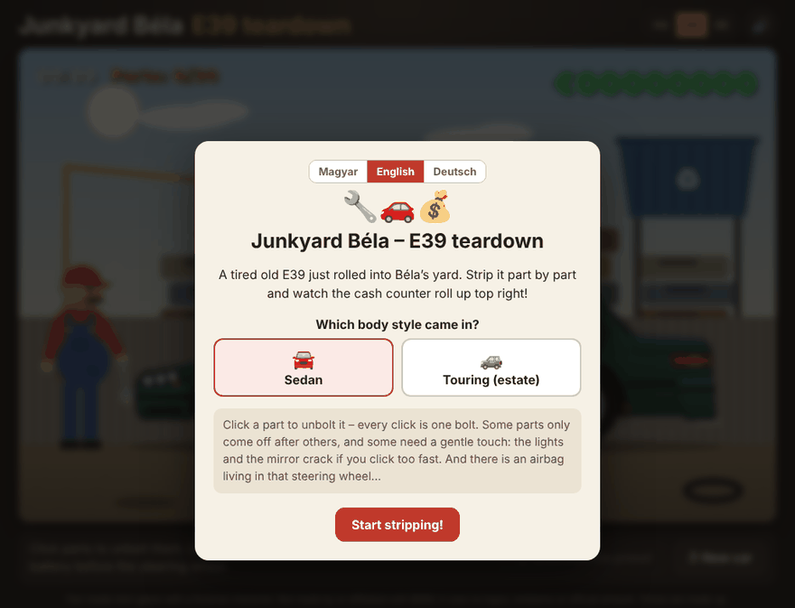

# Bontó Béla – E39 bontás

Böngészős minijáték: Béla bontótelepére megérkezett egy kiöregedett E39 – szedán vagy Touring, te választod. Szedd szét alkatrészenként, és nézd, ahogy a GTA-stílusú pénzszámláló pörög jobb fent. Magyarul, angolul és németül is játszható.

| Touring | Szedán |
|---|---|
|  |  |

## Menete

- Az elején kiválasztod a karosszériát: **szedán** (csomagtérfedéllel) vagy **Touring** (kombi, csomagtérajtóval).
- Kattints egy alkatrészre – **minden kattintás egy csavar**. Ha az utolsó is kijött, az alkatrész a konténerbe repül, és jön a pénz.
- **Sorrend számít:** a motorhoz előbb a motorháztető és a hűtő kell, a hűtőhöz az első lökhárító, az ajtóhoz a tükör. Az ülések és a kormány csak ajtó nélkül látszanak, a váltó csak motor nélkül. Ha valamit túl korán próbálsz, Béla rád szól.
- **Törékeny alkatrészek:** a fényszóró, a hátsó lámpa és a tükör megreped, ha túl gyorsan kattintgatsz – cserépért csak az ár töredéke jár.
- **Légzsák-csapda:** ha a kormányt az akkumulátor kikötése előtt szeded le, kiold a légzsák (és Béla szemöldöke bánja).
- Ha a kaszni teljesen kopasz, mehet a **présbe** – a vasért még jár egy kis pénz, aztán jön az értékelés és a megosztható eredmény.

20 alkatrész: kerekek, lámpák, tükör, lökhárítók, motorháztető, csomagtérajtó, ajtók, akkumulátor, hűtő, motor, váltó, ülések, kormány, katalizátor, kipufogó.

| Motortér: rossz sorrend | Ajtó nélkül látszik az utastér |
|---|---|
|  |  |
| **Légzsák! (német nyelven)** | **Kopasz kaszni** |
|  |  |
| **Prés** | **Kész** |
|  |  |

**Nyelvválasztás** (HU / EN / DE) a kezdőképernyőn és a fejlécben; angolul és németül euróban számol:



## Technika

- TypeScript (strict) + HTML Canvas 2D, Vite – keretrendszer nélkül
- Minden grafika kódból rajzolva (nincs képfájl), két karosszériaváltozattal; minden alkatrész saját `Path2D` alakzat, ugyanaz szolgál rajzolásra és kattintás-felismerésre
- A bontási szabályok (alkatrészek, árak, előfeltételek, takarások, törékenység, légzsák) DOM-mentes modulban, `node:test` tesztekkel – köztük körmentesség-ellenőrzés a függőségi gráfon
- Hangok Web Audio API-val szintetizálva, szövegek külön fordítási modulban (`src/i18n.ts`)
- Végigjátszás Playwright-tal tesztelve (hibátlan és „mindent elrontó” bontás, mobil érintés)
- GitHub Actions → GitHub Pages deploy

```bash
npm install
npm run dev     # fejlesztői szerver
npm test        # logikai tesztek
npm run build   # dist/
```

## English

A browser mini-game set in a junkyard: strip an old E39 (sedan or Touring) part by part while a GTA-style cash counter rolls up. Parts have prerequisites, fragile glass cracks if you rush it, and pulling the steering wheel before disconnecting the battery fires the airbag. Ends with the bare shell going into the press. Playable in Hungarian, English and German. TypeScript + Canvas 2D, no image files, game rules covered by unit tests.

## Jogi megjegyzés

Rajongói játék, kitalált szereplővel. Nem a BMW terméke, nem kapcsolódik hozzá és nem támogatja. A játék nem használ logót, emblémát vagy gyári grafikát; az autó saját rajz, a típusnév csak azonosításra szerepel. Az árak kitaláltak.

MIT licenc.
